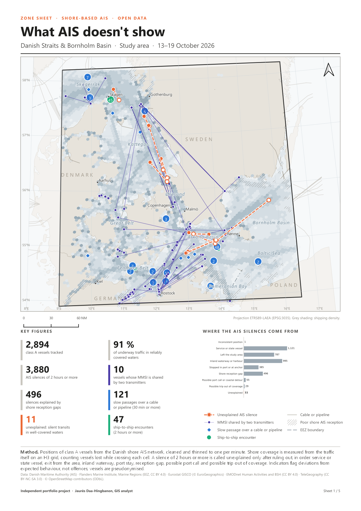
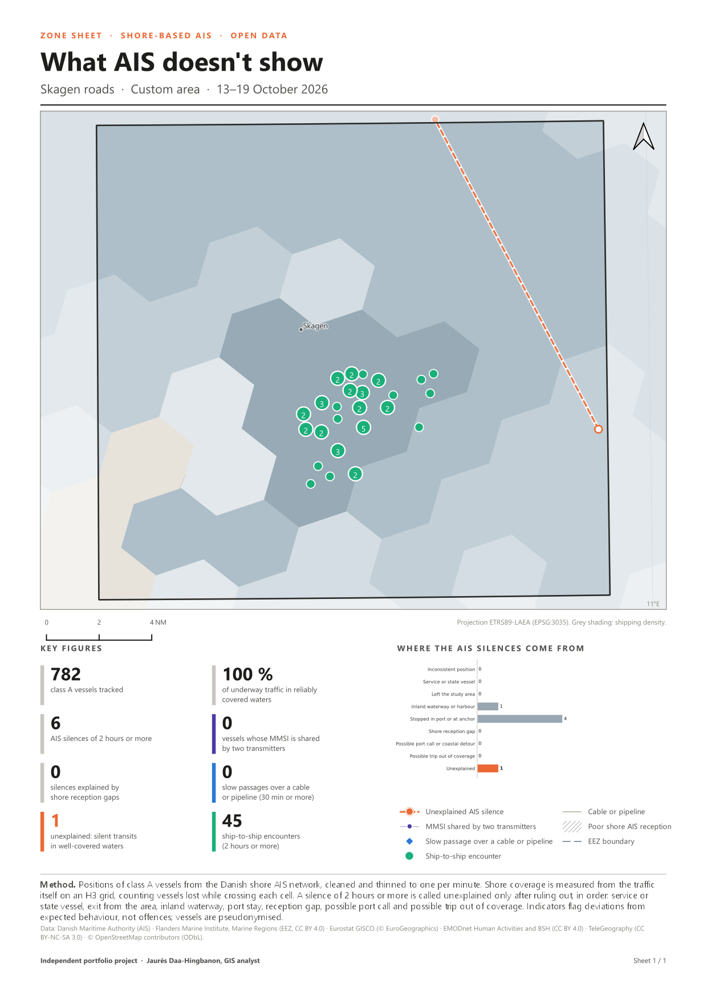
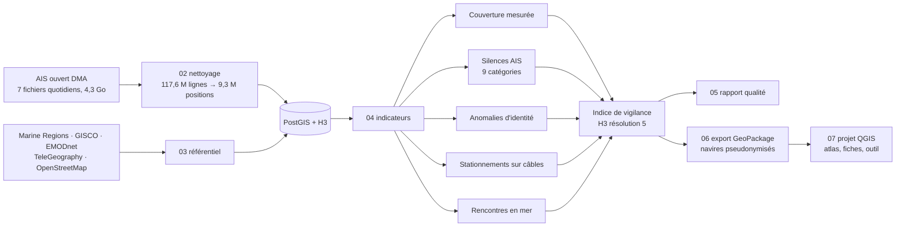

# What AIS doesn't show

**Ce que l'AIS ne montre pas : angles morts du réseau AIS côtier et silences inexpliqués, détroits danois et bassin de Bornholm, 13–19 octobre 2026**

[English version](README.md)

Une chaîne SIG reproductible, construite uniquement sur des données ouvertes. Elle mesure où le réseau AIS côtier perd réellement les navires, puis sépare les silences AIS ordinaires de ceux qu'aucune explication ordinaire ne justifie. Elle signale aussi les conflits d'identité, les passages lents au-dessus des câbles sous-marins et les rencontres en mer, et les combine en un indice de vigilance sur une grille H3.

> Projet personnel de démonstration, sur données ouvertes uniquement. Les indicateurs signalent des écarts au comportement attendu, pas des infractions : aucun navire n'est nommé ni mis en cause, et les productions publiques sont agrégées ou pseudonymisées.

## Une semaine en chiffres

| | |
|---|---:|
| Messages AIS traités | 117,6 millions |
| Navires de classe A suivis | 2 894 |
| Silences AIS de 2 heures ou plus | 3 880 |
| … dus aux limites du réseau côtier | 496 |
| … **inexpliqués** : transits silencieux dans des eaux bien couvertes | **11** (10 navires) |
| Navires dont le MMSI est partagé avec un autre émetteur (3 sauts impossibles ou plus) | 10 |
| Passages lents au-dessus d'un câble ou d'un pipeline sous-marin (moins de 2 nœuds, 30 min ou plus) | 121 (42 navires) |
| Rencontres en mer (moins de 500 m, 2 heures ou plus) | 47, dont 45 au large de Skagen |

Le réseau danois est l'un des plus denses d'Europe. Même ici, 9 % des positions de navires en route tombent dans des mailles qu'il ne couvre pas de façon fiable, des émetteurs partagent la même identité, et certains navires se taisent dans des eaux où neuf voisins sur dix sont reçus. Dans chacun de ces cas, une détection qui ne dépend pas de l'émission du navire lui-même (géolocalisation radiofréquence, radar satellitaire) apporte l'information manquante.

Tous les chiffres : [docs/rapport_qualite.md](docs/rapport_qualite.md), généré à partir de la base, sans aucun chiffre saisi à la main.

## Fiches de zone

Une fiche A4 par zone d'intérêt, produite par un atlas QGIS : l'aire d'étude, puis la part de chaque ZEE qui s'y trouve. Les chiffres clés sont calculés par zone dans PostGIS et lus par la mise en page ; la carte, le graphique et le contour suivent la zone automatiquement. Les fiches sont en anglais, pour une diffusion internationale.

[](sorties/fiches/zone-sheets.pdf)

[Les cinq fiches (PDF, 6 Mo)](sorties/fiches/zone-sheets.pdf) · [Vue analyste : couverture mesurée et indice de vigilance](sorties/fiches/coverage-and-vigilance.pdf)

## Une fiche pour n'importe quelle zone : un outil de traitement QGIS

`qgis/outils/fiche_zone.py` ajoute **Produire une fiche de zone** à la boîte à outils de traitement de QGIS. On dessine un polygone dans la couche *My areas of interest* (trois exemples sont fournis), on le sélectionne, on lance l'outil : il calcule les chiffres clés à partir des GeoPackages (aucune base de données nécessaire), dessine le graphique et exporte la fiche A4 en PDF et en PNG, avec la même mise en page que l'atlas. Il fonctionne aussi en lot, une ligne par zone.

Validé sur les cinq zones de l'atlas : les signaux sont identiques ; le nombre de navires est inférieur de 1 à 2,5 % (traces au lieu de positions) et la part du trafic bien couvert peut s'écarter jusqu'à 8 points dans une zone côtière à grands ports. Détails et mode d'emploi pas à pas pour les non-spécialistes : [docs/guide_fiche_zone.md](docs/guide_fiche_zone.md).

| | |
|---|---|
| [](sorties/fiches/zone-sheet_arkona-basin.pdf) | [](sorties/fiches/zone-sheet_skagen-roads.pdf) |
| Bassin d'Arkona | Rade de Skagen |

## Projet QGIS

`qgis/what_ais_doesnt_show.qgz` s'ouvre sur la carte de la fiche et lit `donnees/produites/carto.gpkg` (chemins relatifs, navires pseudonymisés). Il contient :

- des couches rangées par thème (signaux, indicateurs, infrastructures, limites, traces, fond), stylées avec une palette lisible par les daltoniens, vérifiée avec un outil de contrôle des contrastes et de la vision des couleurs ;
- des thèmes de carte : *Zone sheet – main map*, *Shore AIS coverage*, *Vigilance index*, *Infrastructure & loitering*, *All AIS silences*, *Vessel tracks* ;
- des signets : rade de Skagen, bassin d'Arkona, entrée du canal de Kiel, Fehmarn Belt, Øresund, Bornholm, baie de Poméranie ;
- deux mises en page : *Zone sheet* (atlas) et *Coverage & vigilance*.

Le projet est construit par `scripts/07_projet_qgis.py` : un changement de données ou de style se répercute en une commande. Il enregistre sa propre transformation de datum (WGS84 → ETRS89-LAEA) et s'ouvre donc sans aucune question ; l'enquête sur les plantages qui a conduit à ce choix est dans [docs/incidents_qgis.md](docs/incidents_qgis.md). Les traces des navires sont dans un `traces.gpkg` séparé (58 Mo, non versionné, régénéré par `06_export_gpkg.py`).

## Ce qui rend l'analyse fiable

- **La couverture est mesurée, pas supposée.** La réception est calculée par maille H3 à partir du trafic lui-même : part des intervalles d'une minute effectivement reçus, et part des navires attendus perdus en traversant la maille. Cette seconde mesure corrige un biais de sélection découvert pendant la mise au point : des silences se concentraient sur un même tronçon de route, pour des navires différents à des heures différentes, dans des mailles affichant 98 % de réception. Un navire jamais reçu ne laisse aucune trace : la réception seule surestime donc la couverture. La mesure des navires perdus déclasse 288 mailles.
- **« Inexpliqué » se mérite.** Un silence est rangé dans neuf catégories, de la plus ordinaire (bateau-pilote, escale, voie navigable intérieure, bord de l'aire d'étude, trou de réception, sortie possible de la couverture) à *inexpliqué*. Il n'atteint cette dernière que si le navire est resté dans des eaux bien couvertes, si le réseau recevait ses voisins heure par heure, et s'il n'avait pas le temps de sortir de la couverture et d'y revenir.
- **Chaque ligne écartée est comptée.** Le nettoyage consigne chaque ligne rejetée avec son motif (`qualite.bilan_nettoyage`) : 28 % des lignes brutes sont des doublons exacts, reçus par plusieurs stations.
- **Une seule source pour les seuils.** Tous les seuils sont réunis dans `scripts/config.py` et passés au SQL comme variables : en modifier un et relancer `04_indicateurs.py` refait toute l'analyse. Chaque seuil est justifié dans [docs/methode.md](docs/methode.md).

## Chaîne de traitement



| Script | Rôle |
|---|---|
| `00_base.py` | Crée et démarre une instance PostgreSQL propre au projet (PostGIS 3.5, h3-pg 4.1), sans mot de passe, port 5434 |
| `01_telecharger_ais.py` | Télécharge les fichiers AIS quotidiens de l'Autorité maritime danoise, sans retélécharger les fichiers complets |
| `02_nettoyer_ais.py` | Lit chaque ZIP sans le décompresser, nettoie en 7 étapes tracées, charge les positions par `COPY` |
| `03_referentiel.py` | ZEE, mers territoriales, limites maritimes, terres, câbles et pipelines de trois sources, parcs éoliens, mouillages, table des pavillons |
| `04_indicateurs.py` | Exécute `sql/03` à `sql/11` : navires, couverture, géométries de travail, silences, identité, infrastructures, rencontres, indice, cartographie |
| `05_rapport.py` | Écrit `docs/rapport_qualite.md` à partir de la base |
| `06_export_gpkg.py` | Exporte les couches d'affichage en GeoPackage, navires pseudonymisés, chiffres et graphiques des zones |
| `07_projet_qgis.py` | Construit le projet QGIS (styles, thèmes, signets, mises en page) et exporte les fiches ; s'exécute dans QGIS ou avec le Python de QGIS |
| `run_all.py` | Toute la chaîne ; `--depuis 04` reprend à une étape donnée |

## Lancer la chaîne

Prérequis : Python 3.10 avec les paquets de `requirements.txt` ; PostgreSQL 15 avec PostGIS 3.5 et les extensions h3-pg 4.1 (`h3`, `h3_postgis`). Les chemins de PostgreSQL et du Python de QGIS sont dans `scripts/config.py`.

```bash
python scripts/run_all.py
```

Compter une quarantaine de minutes sur un portable, et 4,3 Go téléchargés au premier passage. L'étape 07 utilise le Python de QGIS (`python-qgis-ltr.bat`). Les données brutes ne sont pas versionnées : les scripts les téléchargent à nouveau.

## Organisation du dépôt

```
scripts/        chaîne de traitement (00 à 07), configuration, scripts SQL dans scripts/sql/
docs/           méthode, sources et licences, rapport qualité généré, guide de l'outil, note d'incident
donnees/        téléchargements bruts (non versionnés) et GeoPackages de cartographie
qgis/           projet QGIS, outil de traitement (qgis/outils/) et graphiques des fiches
sorties/        fiches de zone exportées (PDF, PNG)
```

## Limites

- Au-delà des eaux danoises, la couverture AIS repose sur une réception à longue distance qui varie avec la météo : le projet la mesure, mais ne peut pas la supprimer.
- Les tracés publics des câbles et pipelines sont indicatifs. Trois sources sont combinées et documentées dans [docs/sources.md](docs/sources.md).
- Un silence inexpliqué peut encore venir d'un émetteur défaillant ou d'une antenne mal placée. Les indicateurs disent où regarder, pas ce qui s'est passé.
- Une semaine de données : les indicateurs décrivent cette semaine, pas une tendance de fond.

## Pour aller plus loin

- **Détections radar Sentinel-1** de Global Fishing Watch comme source indépendante : les navires vus par le radar mais absents de l'AIS.

## Documentation

[Méthode](docs/methode.md) · [Sources et licences](docs/sources.md) · [Rapport qualité](docs/rapport_qualite.md) · [Guide de l'outil de fiche de zone](docs/guide_fiche_zone.md) · [Note d'incident QGIS](docs/incidents_qgis.md)

## Données

Autorité maritime danoise (AIS), Flanders Marine Institute / Marine Regions (CC BY 4.0), Eurostat GISCO (© EuroGeographics), EMODnet Human Activities et BSH (CC BY 4.0), TeleGeography (CC BY-NC-SA 3.0), © contributeurs OpenStreetMap (ODbL). Détails dans [docs/sources.md](docs/sources.md).
