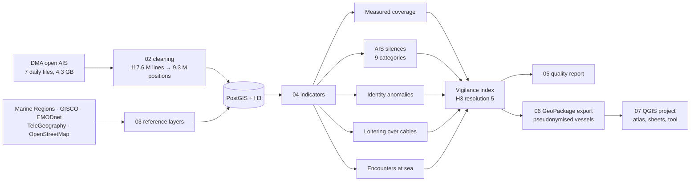

# What AIS doesn't show

**Shore-based AIS blind spots and unexplained silences — Danish Straits and Bornholm Basin, 13–19 October 2026**

A reproducible GIS pipeline, built on open data only, that measures where the coastal AIS network actually loses track of vessels, then separates ordinary AIS silences from the ones nothing ordinary can explain. It also flags identity conflicts, slow passages over submarine cables and ship-to-ship encounters, and combines them into a vigilance index on an H3 grid.

> Independent portfolio project. Open data only. The indicators flag deviations from expected behaviour, not offences: no vessel is named or accused, and public outputs are aggregated or pseudonymised.

[Version française](README.fr.md)

## One week in figures

| | |
|---|---:|
| AIS messages processed | 117.6 million |
| Class A vessels tracked | 2,894 |
| AIS silences of 2 hours or more | 3,880 |
| … explained by limits of the shore network | 496 |
| … **unexplained**: silent transits through well-covered waters | **11** (10 vessels) |
| Vessels whose MMSI is shared with another transmitter (3+ impossible jumps) | 10 |
| Slow passages over submarine cables or pipelines (< 2 kn, 30 min or more) | 121 (42 vessels) |
| Ship-to-ship encounters (< 500 m, 2 hours or more) | 47, of which 45 off Skagen |

The Danish network is one of the densest in Europe. Even here, 9 % of underway positions fall in cells it does not cover reliably, transmitters share identities, and some vessels fall silent in waters where nine neighbours in ten are received. Each of these is a case where a detection that does not depend on the vessel's own broadcast (radio-frequency geolocation, satellite radar) supplies the missing information.

Full figures: [docs/rapport_qualite.md](docs/rapport_qualite.md) (generated from the database, no number typed by hand).

## Zone sheets

One A4 sheet per area of interest, generated by a QGIS atlas: the study area, then the part of each EEZ inside it. Key figures are computed per zone in PostGIS and read by the layout; the map, the chart and the outline follow the zone automatically.

[](sorties/fiches/zone-sheets.pdf)

[All five sheets (PDF, 6 MB)](sorties/fiches/zone-sheets.pdf) · [Analyst view: measured coverage and vigilance index](sorties/fiches/coverage-and-vigilance.pdf)

## Zone sheet for any area: a QGIS Processing tool

`qgis/outils/fiche_zone.py` adds **Produire une fiche de zone** to the QGIS Processing toolbox. Draw a polygon in the *My areas of interest* layer (three examples are provided), select it, run the tool: it computes the key figures from the GeoPackages (no database needed), draws the chart and exports the A4 sheet to PDF and PNG with the same layout as the atlas. It also runs in batch, one row per area.

Validated against the five atlas zones: signal counts are identical; vessel counts are 1 to 2.5 % lower (tracks instead of positions) and the coverage share can differ by up to 8 points in a coastal zone with large ports. Details and step-by-step guide for non-specialists: [docs/guide_fiche_zone.md](docs/guide_fiche_zone.md) (in French).

| | |
|---|---|
| [](sorties/fiches/zone-sheet_arkona-basin.pdf) | [](sorties/fiches/zone-sheet_skagen-roads.pdf) |
| Arkona Basin | Skagen roads |

## QGIS project

`qgis/what_ais_doesnt_show.qgz` opens on the sheet map and reads `donnees/produites/carto.gpkg` (relative paths, vessels pseudonymised). It contains:

- layers grouped by theme (signals, indicators, infrastructure, boundaries, tracks, base), styled with a colour-blind-safe palette checked with a contrast and colour-vision validator;
- map themes: *Zone sheet – main map*, *Shore AIS coverage*, *Vigilance index*, *Infrastructure & loitering*, *All AIS silences*, *Vessel tracks*;
- spatial bookmarks: Skagen roads, Arkona Basin, Kiel Canal entrance, Fehmarn Belt, Øresund, Bornholm, Pomeranian Bay;
- two print layouts: *Zone sheet* (atlas) and *Coverage & vigilance*.

The project is built by `scripts/07_projet_qgis.py`, so a change of data or style is one command away. It stores its own datum transformation (WGS84 → ETRS89-LAEA), so it opens without any prompt; the crash investigation behind that choice is in [docs/incidents_qgis.md](docs/incidents_qgis.md) (in French). Vessel tracks are in a separate `traces.gpkg` (58 MB, not versioned, regenerated by `06_export_gpkg.py`).

## What makes the analysis trustworthy

- **Coverage is measured, not assumed.** Reception is computed per H3 cell from the traffic itself: share of 1-minute intervals actually received, and share of expected vessels lost while crossing the cell. The second measure corrects a selection bias found during development: silences clustered on the same stretch of route, for different vessels at different hours, in cells showing 98 % reception. Vessels that are never received leave no trace, so reception alone overstates coverage; 288 cells are downgraded by the lost-vessel measure.
- **"Unexplained" is earned.** A silence is classified in nine categories, from the most ordinary (pilot boat, port stay, inland waterway, edge of study area, reception gap, possible trip out of coverage) to *unexplained*. It reaches the last one only if the vessel stayed in well-covered waters, the network was receiving its neighbours hour by hour, and it had no time to leave coverage and come back.
- **Every rejected record is accounted for.** The cleaning step logs each discarded line with its reason (`qualite.bilan_nettoyage`): 28 % of raw lines are exact duplicates received by several stations.
- **One source of truth for thresholds.** All thresholds live in `scripts/config.py` and are passed to SQL as variables; changing one and rerunning `04_indicateurs.py` redoes the whole analysis. Each threshold is justified in [docs/methode.md](docs/methode.md).

## Pipeline



| Script | Role |
|---|---|
| `00_base.py` | Creates and starts a project-local PostgreSQL instance (PostGIS 3.5, h3-pg 4.1), no password, port 5434 |
| `01_telecharger_ais.py` | Downloads the daily AIS files of the Danish Maritime Authority, skips complete files |
| `02_nettoyer_ais.py` | Streams each ZIP without unpacking it, cleans in 7 logged steps, loads positions with `COPY` |
| `03_referentiel.py` | EEZs, territorial seas, maritime boundaries, land, cables and pipelines from three sources, wind farms, anchorages, flag table |
| `04_indicateurs.py` | Runs `sql/03` to `sql/11`: vessels, coverage, working geometries, silences, identity, infrastructure, encounters, index, mapping layers |
| `05_rapport.py` | Writes `docs/rapport_qualite.md` from the database |
| `06_export_gpkg.py` | Exports display layers to GeoPackage with pseudonymised vessels, zone figures and charts |
| `07_projet_qgis.py` | Builds the QGIS project (styles, themes, bookmarks, layouts) and exports the sheets; runs inside QGIS or with QGIS's Python |
| `run_all.py` | Whole chain; `--depuis 04` resumes at a given step |

## Run it

Requirements: Python 3.10 with the packages in `requirements.txt`; PostgreSQL 15 with PostGIS 3.5 and the h3-pg 4.1 extensions (`h3`, `h3_postgis`). Paths to PostgreSQL and to QGIS's Python are set in `scripts/config.py`.

```bash
python scripts/run_all.py
```

About 40 minutes on a laptop, 4.3 GB downloaded on the first run. Step 07 runs with QGIS's Python (`python-qgis-ltr.bat`, path in `scripts/config.py`). Raw data are not versioned and are fetched again by the scripts.

## Repository layout

```
scripts/        pipeline (00 to 07), configuration, SQL scripts in scripts/sql/
docs/           method, data sources and licences, generated quality report, tool guide, incident note
donnees/        raw downloads (not versioned) and GeoPackages for mapping
qgis/           QGIS project, Processing tool (qgis/outils/) and the charts used by the zone sheets
sorties/        exported zone sheets (PDF, PNG)
```

## Limits

- AIS coverage beyond Danish waters relies on long-range reception and varies with weather; the project measures it but cannot remove it.
- Public cable and pipeline routes are indicative. Three sources are combined and documented in [docs/sources.md](docs/sources.md).
- An unexplained silence can still come from a faulty transmitter or a badly placed antenna. The indicators tell where to look, not what happened.
- One week of data: indicators describe that week, not a long-term pattern.

## Next steps

- **Sentinel-1 radar detections** from Global Fishing Watch as an independent source: vessels seen by radar but absent from AIS.

## Data

Danish Maritime Authority (AIS), Flanders Marine Institute / Marine Regions (CC BY 4.0), Eurostat GISCO (© EuroGeographics), EMODnet Human Activities and BSH (CC BY 4.0), TeleGeography (CC BY-NC-SA 3.0), © OpenStreetMap contributors (ODbL). Details in [docs/sources.md](docs/sources.md).
