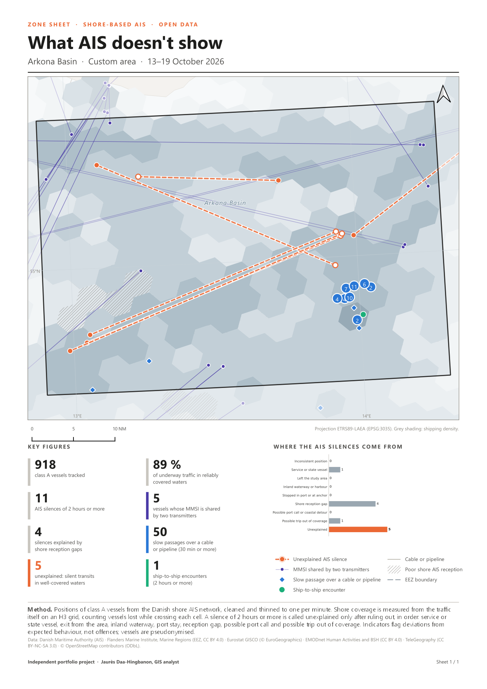

# Guide : produire une fiche de zone

*Pour les équipes marketing, commerciales et produit. Aucune connaissance en programmation n'est nécessaire ; une première prise en main de QGIS suffit (ouvrir un projet, sélectionner une entité).*

L'outil **Produire une fiche de zone** fabrique, pour n'importe quelle zone maritime de la période étudiée, une fiche A4 en anglais prête à joindre à une proposition commerciale : chiffres clés, carte, graphique des silences AIS, légende, méthode et sources. Compter **deux minutes** par fiche.



---

## 1. Avant de commencer

| Il faut | Où le trouver |
|---|---|
| QGIS 3.34 ou plus récent | [qgis.org](https://qgis.org) |
| Le projet `qgis/what_ais_doesnt_show.qgz` | Dossier du projet ; il s'ouvre sur la carte de la fiche |
| Les données `donnees/produites/carto.gpkg` et `traces.gpkg` | À côté du projet. Si `traces.gpkg` manque, la fiche s'affiche sans le nombre de navires (voir § 6) |

Les données couvrent **les détroits danois et le bassin de Bornholm, du 13 au 19 octobre 2026**. Une zone dessinée ailleurs donne une fiche aux chiffres nuls.

## 2. Installer l'outil (une seule fois)

1. Ouvrir le projet `qgis/what_ais_doesnt_show.qgz`.
2. Menu **Traitement > Boîte à outils** (ou `Ctrl+Alt+T`).
3. En haut de la boîte à outils, cliquer sur l'icône Python (le logo bleu et jaune), puis **Ajouter un script à la boîte à outils…**
4. Choisir le fichier `qgis/outils/fiche_zone.py`.

L'outil apparaît dans **Scripts > What AIS doesn't show > Produire une fiche de zone**.

> Variante pour une équipe : **Préférences > Options > Traitement > Scripts > Dossiers de scripts**, ajouter le dossier `qgis/outils`. L'outil se met alors à jour tout seul quand le fichier évolue.

## 3. Produire une fiche en quatre étapes

### Étape 1 : dessiner la zone

Le groupe **Zone sheets** contient la couche **My areas of interest**, avec trois exemples déjà dessinés (Arkona Basin, Skagen roads, Fehmarn Belt).

1. Sélectionner la couche **My areas of interest** dans le panneau des couches.
2. Cliquer sur le crayon **Basculer en mode édition**.
3. Cliquer sur **Ajouter une entité polygone**, puis cliquer sur la carte pour placer les sommets ; **clic droit** pour terminer.
4. Dans la fenêtre qui s'ouvre, saisir le **nom en anglais** (il servira de titre à la fiche), par exemple `Great Belt`.
5. Cliquer à nouveau sur le crayon et **enregistrer**.

> Pour réutiliser une zone existante (une ZEE, une zone de pêche, un parc éolien), il suffit de la sélectionner dans sa propre couche : l'outil accepte n'importe quelle couche de polygones.

### Étape 2 : sélectionner la zone

Outil **Sélectionner des entités** (flèche jaune), puis cliquer sur la zone. Elle passe en jaune.

### Étape 3 : lancer l'outil

Double-cliquer sur **Produire une fiche de zone** dans la boîte à outils, puis renseigner :

| Paramètre | Que mettre |
|---|---|
| **Zone (couche de polygones)** | `My areas of interest`, et cocher **Entités sélectionnées uniquement** |
| **Nom de la zone** | Laisser vide pour reprendre le nom du polygone, ou saisir un autre titre (en anglais) |
| **Fiche PDF** | `…` > **Enregistrer vers un fichier**, par exemple `sorties/fiches/zone-sheet_great-belt.pdf` |
| **Exporter aussi une image PNG** | Coché par défaut : une image à côté du PDF, pratique pour un courriel ou une présentation |

Cliquer sur **Exécuter**. Le journal affiche les chiffres calculés ; la fiche est prête en général en moins d'une minute.

### Étape 4 : vérifier la fiche

Ouvrir le PDF. Avant de l'envoyer, vérifier trois points : le titre, le cadrage de la carte sur la zone, et la cohérence des chiffres avec ce que montre la carte.

> **Plusieurs zones d'un coup** : clic droit sur l'outil > **Exécuter comme processus de lot**, une ligne par zone.

## 4. Lire la fiche

| Bloc | Ce qu'il dit |
|---|---|
| **Carte** | La zone encadrée, le reste voilé. Gris : densité du trafic. Hachures : eaux où le réseau AIS côtier perd des navires. Orange : silences inexpliqués (rond creux au début, plein à la fin). Violet : MMSI partagés. Losanges bleus : passages lents au-dessus d'un câble ou d'un pipeline. Vert : rencontres en mer. Un chiffre dans un cercle regroupe des points superposés. |
| **Class A vessels tracked** | Navires de classe A (commerce, passagers, grande pêche) dont la trace traverse la zone. |
| **AIS silences of 2 hours or more** | Silences d'au moins 2 heures commencés dans la zone, toutes explications confondues. |
| **Silences explained by shore reception gaps** | Silences dus aux limites du réseau AIS côtier, pas au navire. |
| **Unexplained** (orange) | Le navire est resté dans des eaux bien couvertes, sans avoir le temps d'en sortir, et il s'est tu. |
| **% of underway traffic in reliably covered waters** | Part du trafic que le réseau côtier suit sans perte. Plus elle est basse, plus une détection indépendante de l'AIS apporte d'information. |
| **Vessels whose MMSI is shared** | Navires dont l'identifiant est émis par deux émetteurs à la fois (trois sauts impossibles ou plus). |
| **Slow passages over a cable or pipeline** | Navires à moins de 2 nœuds, à moins de 750 m d'une infrastructure sous-marine, pendant au moins 30 minutes, hors ports, mouillages et parcs éoliens. |
| **Ship-to-ship encounters** | Deux navires à moins de 500 m, quasi immobiles, pendant au moins 2 heures, hors abris. |
| **Graphique** | Les silences de la zone rangés par explication, de la plus ordinaire (navire de servitude, sortie de zone, port…) à l'absence d'explication. |

**Ce qu'il ne faut pas écrire** dans une proposition : qu'un navire « a coupé son AIS pour dissimuler une activité ». La fiche signale des écarts au comportement attendu, pas des infractions ; une panne d'émetteur reste possible. La formulation juste : *« X silences inexpliqués par la couverture du réseau côtier, que seule une détection indépendante de l'AIS permet de lever »*.

## 5. Comment l'outil calcule

L'outil lit les GeoPackages du projet ; il n'a besoin ni de la base PostgreSQL ni d'Internet. Les définitions sont celles des fiches de l'atlas ([méthode](methode.md)) :

- un silence est rattaché à la zone où il **commence** ; un saut de position, à son point de départ ;
- le nombre de navires est compté sur les **traces** (positions reliées) qui traversent la zone ;
- la part du trafic bien couvert est calculée sur les mailles H3 de 36 km², au prorata de leur surface dans la zone.

**Contrôle sur les cinq zones de l'atlas** (atlas calculé sur les positions dans PostGIS, outil sur les GeoPackages) :

| Zone | Navires | Silences | Inexpliqués | MMSI partagés | Stationnements | Rencontres | Trafic bien couvert |
|---|---:|---:|---:|---:|---:|---:|---:|
| Aire d'étude | 2 894 / 2 851 | 3 880 / 3 880 | 11 / 11 | 10 / 10 | 121 / 121 | 47 / 47 | 91 % / 91 % |
| ZEE danoise | 2 002 / 1 983 | 196 / 183 | 2 / 2 | 8 / 8 | 32 / 32 | 46 / 46 | 98 % / 98 % |
| ZEE suédoise | 1 429 / 1 423 | 628 / 652 | 9 / 9 | 4 / 4 | 6 / 6 | 0 / 0 | 94 % / 94 % |
| ZEE allemande | 1 203 / 1 189 | 1 338 / 1 313 | 0 / 0 | 4 / 4 | 83 / 83 | 1 / 1 | 69 % / 77 % |
| ZEE polonaise | 281 / 274 | 214 / 218 | 0 / 0 | 1 / 1 | 0 / 0 | 0 / 0 | 50 % / 52 % |

Les signaux (silences inexpliqués, MMSI partagés, stationnements, rencontres) sont identiques. Trois écarts sont connus :

- **navires** : 1 à 2,5 % de moins, car un navire reçu une seule fois n'a pas de trace ;
- **silences** dans les ZEE : quelques unités, car le contour des ZEE du GeoPackage est simplifié à 150 m et les silences au ras de la côte basculent d'un côté ou de l'autre ;
- **trafic bien couvert** : jusqu'à 8 points d'écart dans une zone côtière à grands ports (ZEE allemande). Les approches portuaires, mal couvertes, ne pèsent qu'une fraction des mailles de 36 km² qu'elles occupent. Pour un chiffre de référence sur une telle zone, utiliser la fiche de l'atlas.

## 6. En cas de problème

| Message ou symptôme | Cause et solution |
|---|---|
| *Couche « silence_ais » introuvable* | Le projet n'est pas ouvert : ouvrir `qgis/what_ais_doesnt_show.qgz`, puis relancer. |
| *Mise en page « Zone sheet » introuvable* | La mise en page a été renommée ou supprimée : rouvrir le projet d'origine ou le reconstruire (`scripts/07_projet_qgis.py`). |
| *traces.gpkg absent : nombre de navires non calculé* | Les traces ne sont pas versionnées (58 Mo) ; les régénérer avec `scripts/06_export_gpkg.py`. La fiche est produite, la tuile « vessels tracked » reste vide. |
| Tous les chiffres sont à 0 | La zone est hors de l'aire d'étude, ou la mauvaise couche est choisie. |
| La fiche montre toute une couche de zones fusionnées | « Entités sélectionnées uniquement » n'était pas coché : l'outil fusionne tous les polygones de la couche. |
| Le titre reste « Area of interest » | Ni nom saisi, ni champ `nom` ou `name` renseigné sur le polygone, ou plusieurs polygones sélectionnés. |

## 7. Pour aller plus loin

- **Modifier l'apparence** : la mise en page **Zone sheet** du projet sert de modèle ; toute modification (texte, couleur, logo) se retrouve dans les fiches suivantes. Pour la rendre durable, la reporter dans `scripts/07_projet_qgis.py`.
- **Depuis la console Python de QGIS** :

```python
processing.run("script:fiche_zone", {
    "ZONE": "My areas of interest", "NOM": "Great Belt",
    "SORTIE": "D:/…/sorties/fiches/zone-sheet_great-belt.pdf", "PNG": True})
```
